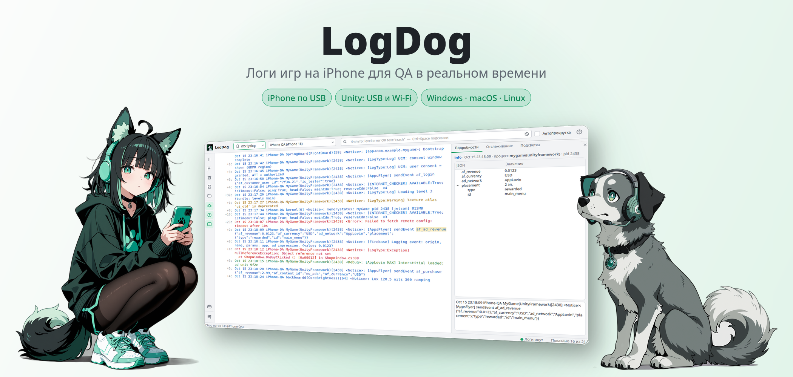
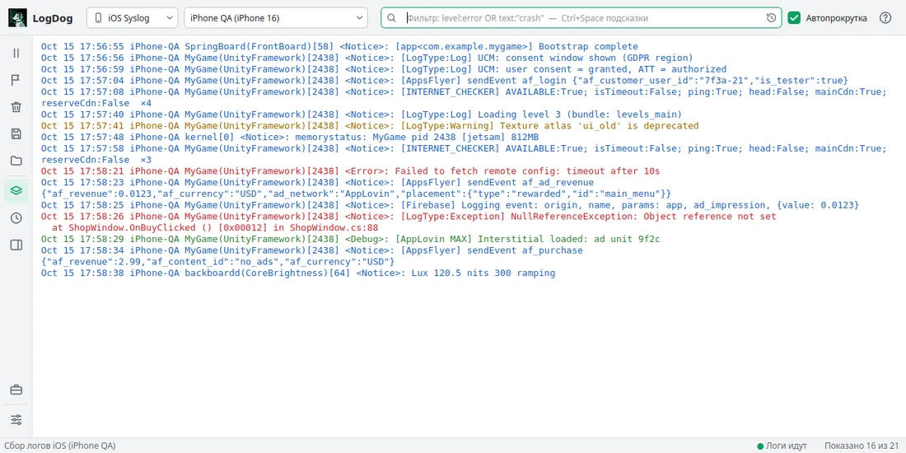
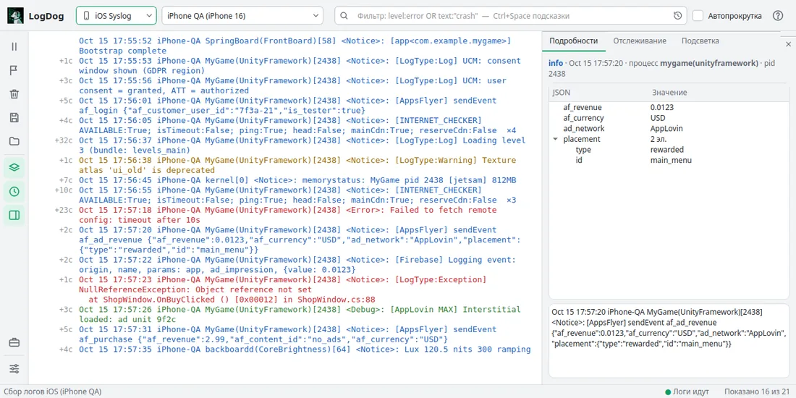
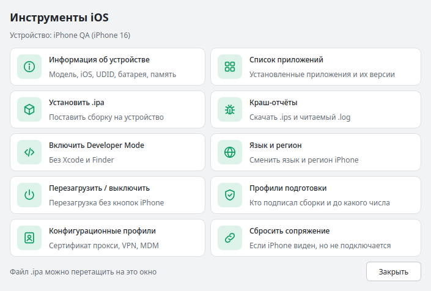
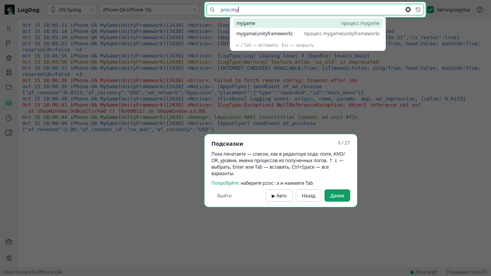

<a href="../../releases/latest">
  <picture>
    <source media="(prefers-color-scheme: dark)" srcset="assets/readme/hero-dark.png">
    
  </picture>
</a>

<p align="center">
  <a href="../../releases/latest"></a>
  <a href="../../releases/latest"></a>
  <a href="../../releases/latest"></a>
</p>

<p align="center">
  <a href="#в-действии"><b>В действии</b></a> ·
  <a href="#возможности"><b>Возможности</b></a> ·
  <a href="#установка"><b>Установка</b></a> ·
  <a href="#первые-шаги"><b>Первые шаги</b></a> ·
  <a href="#фильтр"><b>Фильтр</b></a> ·
  <a href="#горячие-клавиши"><b>Горячие клавиши</b></a>
</p>

<br>

## В действии

**Фильтр, который подсказывает.** Подсказки при наборе — как в редакторе кода, фильтр применяется сам, ошибки в нём подчёркиваются и объясняются.

<picture>
  <source media="(prefers-color-scheme: dark)" srcset="assets/readme/demo-filter-dark.webp">
  
</picture>

**Всё о строке — справа.** JSON разобран деревом, `ключ:значение` — таблицей; отслеживание считает нужные события, повторы схлопываются в «×N», слева — сколько прошло между строками.

<picture>
  <source media="(prefers-color-scheme: dark)" srcset="assets/readme/demo-panel-dark.webp">
  
</picture>

## Возможности


Всё для разбора логов игры на iPhone — в одном окне: от подключения по кабелю до краш-отчёта. Без Xcode и сторонних программ, на Windows, macOS и Linux.

<table>
  <tr>
    <td width="33%" valign="top">
      <br>
      <b>iPhone по USB</b><br>
      Системные логи без Xcode и сторонних программ. Выдернули кабель — видно сразу, подключили — логи продолжаются сами.
    </td>
    <td width="33%" valign="top">
      <br>
      <b>Полные логи Unity — по USB или Wi-Fi</b><br>
      Системный лог iOS прячет строки игры за <code>&lt;private&gt;</code>. LogDog читает логи Unity-игры с iPhone целиком. Игра находится сама — по кабелю или в сети.
    </td>
    <td width="33%" valign="top">
      <br>
      <b>Фильтр и поиск</b><br>
      <code>level:</code>, <code>proc:</code>, <code>AND</code> / <code>OR</code> / <code>NOT</code>, скобки. Подсветка синтаксиса, подсказки, история. Поиск Ctrl+F ничего не скрывает.
    </td>
  </tr>
  <tr>
    <td valign="top">
      <br>
      <b>Отслеживание событий</b><br>
      Сколько раз и когда встретилось — например, <code>revenue OR adrevenue</code>, как бы событие ни называлось в логах.
    </td>
    <td valign="top">
      <br>
      <b>Подробности строки</b><br>
      JSON деревом, пары «ключ: значение» таблицей, подсветка нужных слов цветом во всех логах.
    </td>
    <td valign="top">
      <br>
      <b>Маркеры и удобства</b><br>
      Маркер шага теста (Ctrl+M), «×N» для повторов, время между строками, пауза без потери логов, открытие сохранённого лога.
    </td>
  </tr>
  <tr>
    <td valign="top">
      <br>
      <b>Инструменты iPhone</b><br>
      Очистка данных игры без переустановки, установка <code>.ipa</code> с проверкой, язык и регион, профили, перезагрузка.
    </td>
    <td valign="top">
      <br>
      <b>Краши</b><br>
      Уведомление о новом краше, пока iPhone подключён, и выгрузка отчётов: <code>.ips</code> и читаемый <code>.log</code>.
    </td>
    <td valign="top">
      <br>
      <b>Обучение внутри</b><br>
      Пошаговый показ на демо-логах. Тёмная и светлая темы. Обновления — из самой программы, по кнопке.
    </td>
  </tr>
</table>

### Инструменты для iPhone

<picture>
  <source media="(prefers-color-scheme: dark)" srcset="assets/readme/tools-dark.png">
  
</picture>


- **Очистить данные игры без переустановки** — для сборок из TestFlight: игра стартует как в первый раз. Там же — скачать папку игры и лог Unity, удалить приложение.
- **Установить `.ipa`** — LogDog заранее скажет, если сборка не встанет: UDID нет в профиле, профиль истёк, нужна новее iOS. Файл можно просто перетащить на окно.
- **Краш-отчёты** и **уведомления о новых крашах**; от надоедливого процесса — «Не показывать от …».
- Информация об устройстве, список приложений с версиями, язык и регион, профили подготовки и конфигурационные, Developer Mode, сброс сопряжения.

### Обучение прямо в программе

<picture>
  <source media="(prefers-color-scheme: dark)" srcset="assets/readme/tour-dark.png">
  
</picture>


При первом запуске LogDog предложит короткое обучение на демо-логах: нужная кнопка подсвечивается, рядом — пояснение, можно попробовать самому или включить «▶ Авто». Ваши логи и настройки на это время откладываются и возвращаются. Пройти снова — Справка → «Пройти обучение».

## Установка

Скачайте последнюю версию на странице **[Releases](../../releases/latest)**.

| Система | Файл | |
|---|---|---|
| **Windows** | `LogDog-*-windows-setup.exe` | Установщик: без прав администратора, ярлык в «Пуске» по желанию, удаление — через «Установленные приложения» |
| | `LogDog-*-windows-portable.zip` | Без установки: распакуйте и запустите `LogDog\LogDog.exe` |
| **macOS** | `LogDog-*-macos.zip` | Распакуйте и перетащите `LogDog.app` в «Программы» |
| **Linux** | `LogDog-*-linux.AppImage` | `chmod +x LogDog-*.AppImage` и запустите |

> [!NOTE]
> Сборки не подписаны, поэтому при первом запуске система предупредит.
> **Windows:** «Подробнее» → «Выполнить в любом случае». **macOS:** правый клик по `LogDog.app` → «Открыть».
> Дальше обновляться вручную не нужно — LogDog сам предложит новую версию.


**Чтобы видеть iPhone:**
- **Windows** — установите [Apple Devices](https://apps.microsoft.com/detail/9np83lwlpz9k) из Microsoft Store.
- **macOS** — ничего не нужно.
- **Linux** — нужен `usbmuxd`: `sudo apt install usbmuxd` · `sudo pacman -S usbmuxd` · `sudo dnf install usbmuxd`, затем `sudo systemctl start usbmuxd`.

На iPhone при первом подключении нажмите «Доверять этому компьютеру».

## Первые шаги


**iPhone** — подключите по USB и выберите в списке вверху. Логи пойдут сразу.

**Unity — полные логи игры на iPhone.** В системном логе iOS строки Unity-игры часто скрыты как `<private>`. Режим Unity TCP подключается к самой игре и получает её логи целиком.
1. Соберите игру как **Development Build** (File → Build Settings → ☑ Development Build) — релизная сборка Unity логи не отдаёт.
2. Подключите iPhone **по USB** — проще всего: ни Wi-Fi, ни брандмауэр не нужны. Или держите компьютер и iPhone в одной Wi-Fi-сети.
3. Режим **Unity TCP** → в списке выберите iPhone «по USB» (если он один — выберется сам). LogDog ждёт игру: **запустите её — логи пойдут с самого запуска**. Перезапустили игру — подключится снова сам.

В том же списке — игры, найденные в Wi-Fi, IP прошлого раза и «Ввести IP вручную…» (порт LogDog найдёт сам или укажите: `192.168.1.5:55123`). Кнопка ⏹ рядом — отключиться.

> [!TIP]
> Игра не находится по Wi-Fi? Подключите iPhone кабелем — по USB игра находится всегда. Для Wi-Fi: скорее всего, брандмауэр не пропускает её сигнал: разрешите LogDog доступ в частных сетях (Windows спросит при первом подключении) или откройте UDP-порт `54997` — на Linux: `sudo ufw allow 54997/udp`.

## Фильтр


Фильтр — поле вверху окна. Пишите слово, фразу в кавычках или условие по полю (`level:`, `proc:`, `pid:`); условия соединяются `AND`, `OR`, `NOT` и скобками.

| Пишете | Найдёт |
|---|---|
| `crash` | строки со словом crash (регистр не важен) |
| `Failed to fetch` | строки, где есть все три слова |
| `"Has user consent"` | точную фразу |
| `level:error` | только ошибки — или `level:e`, `warn`/`w`, `info`/`i`, `debug`/`d` |
| `level:error OR level:warn` | ошибки и предупреждения |
| `proc:MyGame` | строки процесса (часть имени); с подсистемой — `proc:MyGame(UnityFramework)` |
| `pid:2438` | строки процесса с этим ID |
| `(level:error OR level:warn) AND NOT proc:backboardd` | проблемы, кроме шумного процесса |
| `Exception:` · `http://cdn` | текст с двоеточием — как есть |

Фильтр применяется сам, пока вы печатаете; **Enter** — сразу и сохраняет его в историю (значок часов в поле).

## Горячие клавиши


| Клавиши | Что делает |
|---|---|
| <kbd>Ctrl</kbd>+<kbd>F</kbd> | Поиск по логам |
| <kbd>↓</kbd> <kbd>↑</kbd> · <kbd>Enter</kbd> · <kbd>F3</kbd> / <kbd>Shift</kbd>+<kbd>F3</kbd> | Следующее / предыдущее совпадение |
| <kbd>Ctrl</kbd>+<kbd>M</kbd> | Маркер шага |
| <kbd>Ctrl</kbd>+<kbd>Space</kbd> | Все подсказки в поле фильтра |
| <kbd>Enter</kbd> / <kbd>Tab</kbd> | Вставить подсказку |
| <kbd>Ctrl</kbd>+<kbd>C</kbd> | Скопировать выделенные строки |
| <kbd>Esc</kbd> | Закрыть поиск или подсказки |

## Настройки и удаление


Настройки, история фильтров и журнал LogDog лежат здесь:

| Система | Папка |
|---|---|
| **Windows** | `%LOCALAPPDATA%\LogDog\` |
| **macOS** | `~/Library/Application Support/LogDog/` |
| **Linux** | `~/.local/share/LogDog/` |

**Удалить LogDog.** Windows, установленная версия — «Параметры → Приложения → Установленные приложения → LogDog → Удалить» (спросит, удалить ли и настройки). Portable, macOS, Linux — удалите папку `LogDog`, `LogDog.app` или файл `.AppImage`, а при желании и папку настроек.

<details>
<summary><b>Разработка</b></summary>

<br>

Нужен Python 3.10+.

```bash
git clone https://github.com/TimBeket/LogDog.git
cd LogDog
python -m venv .venv
source .venv/bin/activate        # Windows: .venv\Scripts\activate
pip install -r requirements.txt -r requirements-test.txt
python main.py                   # запустить
pytest                           # тесты
```

`pymobiledevice3` нужен только для iPhone — без него LogDog работает в режиме Unity.

- Локальная сборка: `pip install -r requirements-build.txt`, затем `python build.py` (результат — в `dist/`).
- Картинки этого README собираются из настоящего интерфейса: `python tools/readme_assets.py`.
- Релизы для всех трёх систем собирает GitHub Actions по тегу версии.
- Как устроен проект и о чём помнить при изменениях — в [CLAUDE.md](CLAUDE.md).

</details>
